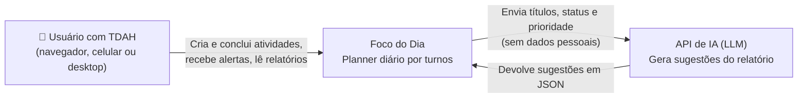
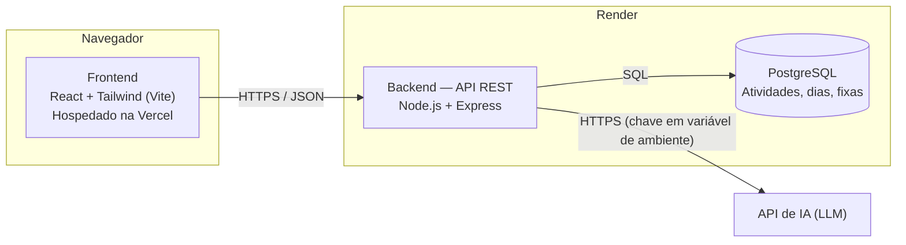
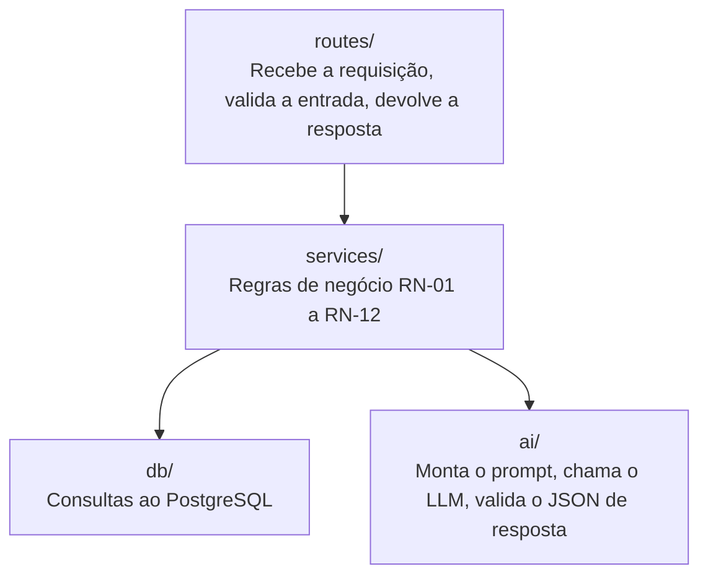
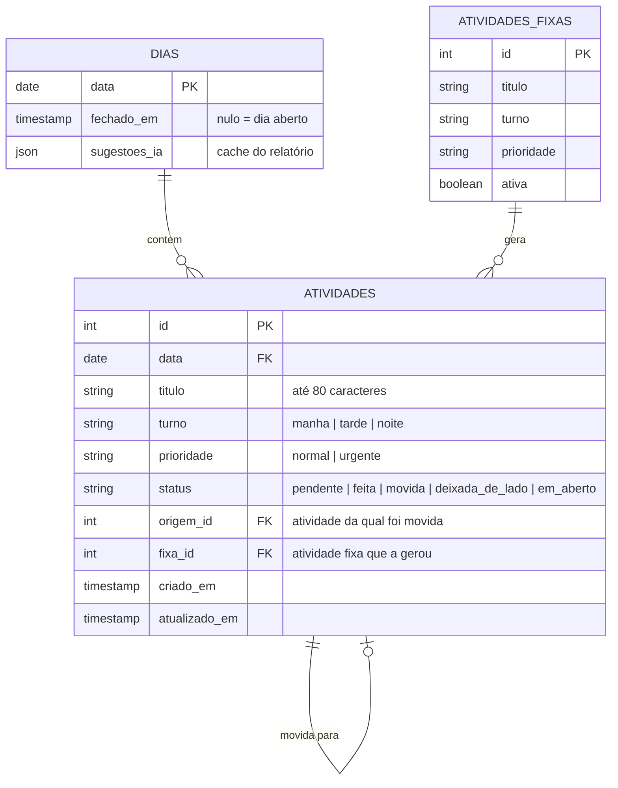
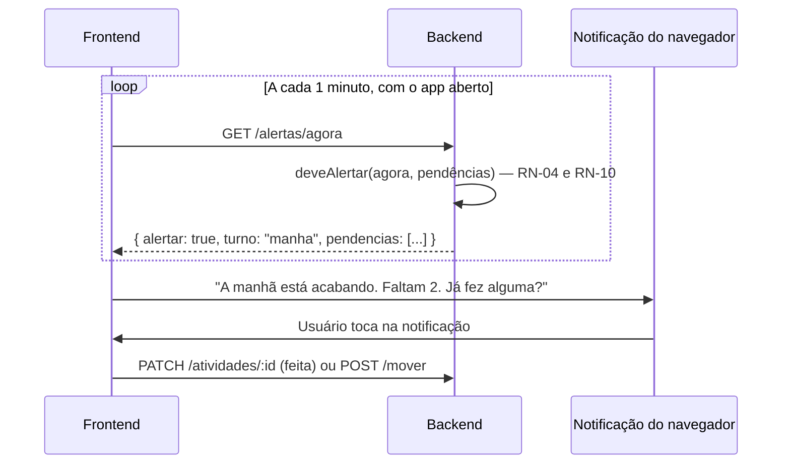

# Foco do Dia — Arquitetura

> Versão 0.1 · 23/10/2026 · Autor: Roberto
> Uso de IA: proposta elaborada com apoio do Claude a partir de `docs/requisitos.md` (v0.2); revisada e validada pelo autor. Decisões registradas em `docs/adr/`.

---

## 1. Visão geral (C4 — nível 1: contexto)

Quem usa o sistema e com quem ele conversa.



## 2. Contêineres (C4 — nível 2)

As partes que serão construídas e onde cada uma roda.



**Por que assim:**
- O frontend nunca fala direto com a IA. A chave fica protegida no backend (RNF-03).
- O frontend só exibe e captura ações. Todas as regras de negócio ficam no backend, onde são testadas (RNF-07).

## 3. Camadas do backend



| Camada | Responsabilidade | Exemplo |
| --- | --- | --- |
| `routes/` | Entrada e saída HTTP. Nada de regra de negócio aqui. | `POST /api/atividades` valida que o título não está vazio |
| `services/` | Regras de negócio puras, fáceis de testar | `deveAlertar(agora, pendencias)` aplica RN-04 |
| `db/` | Acesso ao banco | `buscarAtividadesDoDia(data)` |
| `ai/` | Integração com o LLM, isolada | `gerarSugestoesDoRelatorio(dia)` |

**Princípio:** se a regra muda, só `services/` muda. Se trocarmos de LLM, só `ai/` muda.

## 4. Modelo de dados



**Decisão de modelagem:** quando uma atividade é movida, o registro original fica com status `movida` e uma nova atividade é criada no destino, apontando para a original (`origem_id`). Assim o histórico não se perde, e é ele que alimenta a seção "Atividades pendentes", o relatório semanal e a detecção de atividades recorrentes (RN-08).

## 5. Contrato da API (endpoints)

Base: `/api`. Todas as respostas em JSON.

| Método | Endpoint | O que faz | História |
| --- | --- | --- | --- |
| GET | `/dias/:data` | Dia com atividades por turno (urgentes no topo) | HU-01, HU-08 |
| POST | `/atividades` | Cria atividade (título, turno, prioridade) | HU-01 |
| PATCH | `/atividades/:id` | Edita título, turno, prioridade ou alterna feita/pendente | HU-02, HU-03 |
| DELETE | `/atividades/:id` | Exclui atividade | HU-03 |
| POST | `/atividades/:id/mover` | Move para próximo turno, amanhã ou outra data | HU-05, HU-06, HU-11 |
| POST | `/atividades/:id/deixar-de-lado` | Marca como deixada de lado | HU-06 |
| GET | `/alertas/agora` | Informa se há alerta de troca de turno agora e quais pendências citar | HU-04 |
| GET | `/dias/:data/sugestoes-fechamento` | Destino sugerido para cada pendência (RN-11) | HU-06 |
| POST | `/dias/:data/fechar` | Fecha o dia, aplica os destinos escolhidos e marca o resto como `em_aberto` | HU-06 |
| GET | `/relatorios/diario/:data` | Contagens, listas e sugestões da IA | HU-07, HU-09, HU-10 |
| GET | `/pendencias` | Seção "Atividades pendentes": itens `em_aberto` com data de origem e dias pendentes (fora dos turnos) | HU-11 |
| GET | `/relatorios/semanal?inicio=AAAA-MM-DD` | % por dia e bloco "Atividades pendentes" com os dias em que ficaram pendentes | HU-11 |
| GET / POST | `/fixas` | Lista e cria atividades fixas | HU-09 |
| GET | `/health` | Verifica se a API está no ar | — |

## 6. Fluxos principais

### 6.1 Alerta de troca de turno (HU-04, HU-05)



O frontend só pergunta; quem decide se deve alertar é o backend. Assim a regra é testável e igual para qualquer tela.

### 6.2 Fechamento do dia (HU-06, RN-07)

1. O usuário toca em "Fechar o dia". O frontend chama `GET /dias/:data/sugestoes-fechamento`.
2. Cada pendência vem com o destino sugerido já marcado (RN-11).
3. O usuário confirma tudo, ajusta uma por uma ou escolhe "decidir depois".
4. O frontend chama `POST /dias/:data/fechar`. O backend aplica os destinos, marca o resto como `em_aberto` e registra `fechado_em`. Atividades `em_aberto` deixam de aparecer nos turnos e passam a ser listadas só em `GET /pendencias` (RN-12).

**Fechamento automático às 23h, sem servidor agendado:** o plano gratuito do Render desliga o backend quando não há uso, então não dá para depender de uma tarefa agendada. Usamos **fechamento preguiçoso**: na primeira requisição de um novo dia, o backend verifica se o dia anterior ficou aberto e o fecha aplicando a mesma regra do passo 4. O resultado para o usuário é o mesmo.

### 6.3 Relatório do dia com IA (HU-07, HU-09, HU-10)

1. O frontend chama `GET /relatorios/diario/:data`.
2. O backend calcula contagens e listas no banco. Essa parte não depende de IA.
3. O backend envia à IA os títulos, turnos, status e prioridades do dia e dos últimos 7 dias, sem dados pessoais (RNF-04). O prompt usado é o P-07 de `docs/prompts.md`, com as proteções anti-alucinação do curso C3.
4. A IA devolve um JSON com: plano sugerido para amanhã, candidatas a atividade fixa e pares de atividades parecidas.
5. O backend valida o JSON. Se a IA falhar ou demorar mais de 10 s, devolve o relatório sem sugestões (RNF-05, RNF-06).
6. As sugestões ficam em cache em `dias.sugestoes_ia` para não chamar a IA de novo ao reabrir o relatório.
7. Nada é aplicado sem o usuário aceitar (RN-09).

## 7. Segurança e configuração

| Item | Onde fica |
| --- | --- |
| Chave da API de IA | Variável de ambiente no Render (`LLM_API_KEY`) |
| Endereço do banco | Variável de ambiente no Render (`DATABASE_URL`) |
| Endereço da API no frontend | Variável de ambiente na Vercel (`VITE_API_URL`) |
| Arquivo `.env` local | Listado no `.gitignore`; nunca vai para o GitHub. O repositório tem só um `.env.example` sem valores |
| CORS | Fechado por padrão: só os domínios em `FRONTEND_URL` podem chamar a API pelo navegador |
| Código de acesso | Toda rota em `/api` (exceto `/api/health`) exige `Authorization: Bearer <APP_ACCESS_TOKEN>`. Comparação em tempo constante |
| TLS do banco | Certificado verificado por padrão fora do localhost (`DB_SSL=verify`) |
| Produção | O servidor não inicia sem `FRONTEND_URL`, `APP_ACCESS_TOKEN` e `DATABASE_URL` |
| Limite de requisições | 300 por IP a cada 15 min; 10 tentativas erradas de código de acesso por IP a cada 15 min. **Premissa:** contagem em memória, válida para 1 instância (plano gratuito do Render). Ao escalar para 2 ou mais instâncias, trocar por um armazenamento compartilhado (Redis) |
| Cabeçalhos HTTP | Helmet: `nosniff`, HSTS, CSP, sem `X-Powered-By`. A API só devolve JSON; a CSP padrão não afeta o frontend, que está em outra origem (Vercel) |
| Entradas | Datas que não existem, identificadores fora do limite e corpos acima de 20 KB são recusados com 422/413, nunca 500 |
| Validação de esquemas (curso C4, Unidade 3.1.1) | **Zod** define o formato de cada entrada e saída da API (o equivalente ao Pydantic em Node). O mesmo esquema valida o JSON devolvido pela IA no relatório |
| XSS | O React escapa o texto por padrão; títulos de atividades nunca são renderizados como HTML |
| Consultas ao banco | Sempre parametrizadas na camada `db/`: o comando SQL é fixo e o valor digitado pelo usuário entra separado, como dado. Protege contra SQL injection |

## 8. Estrutura do repositório

```
foco-do-dia/
├── docs/
│   ├── requisitos.md
│   ├── arquitetura.md
│   ├── uso-de-ia.md
│   ├── prompts.md
│   └── adr/
│       ├── ADR-001-stack.md
│       ├── ADR-002-banco-de-dados.md
│       ├── ADR-003-regra-vs-ia-nos-alertas.md
│       └── ADR-004-ferramentas-de-ia.md
├── backend/
│   ├── src/
│   │   ├── routes/
│   │   ├── services/
│   │   ├── db/
│   │   ├── ai/
│   │   └── app.js
│   ├── tests/
│   └── .env.example
├── frontend/
│   ├── src/
│   │   ├── components/
│   │   ├── pages/
│   │   └── api/
│   └── .env.example
├── .github/workflows/ci.yml
└── README.md
```

## 9. Decisões registradas

| ADR | Decisão |
| --- | --- |
| [ADR-001](adr/ADR-001-stack.md) | JavaScript de ponta a ponta: Node + Express no backend, React + Tailwind no frontend |
| [ADR-002](adr/ADR-002-banco-de-dados.md) | PostgreSQL gerenciado em vez de SQLite |
| [ADR-003](adr/ADR-003-regra-vs-ia-nos-alertas.md) | Regra de negócio decide quando alertar; a IA sugere no relatório |
| [ADR-004](adr/ADR-004-ferramentas-de-ia.md) | Claude constrói, Copilot revisa e testa, o autor audita |
